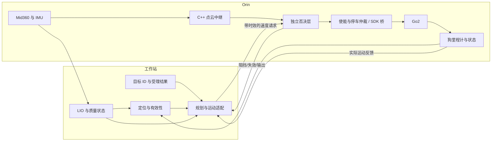

# Go2 自主导航恢复计划

更新：2026-11-05。对应 [工程 review](docs/REVIEW_2026-11-05.md)。

近期目标：在已知平整场地，从已验证起点接收一个目标，可靠完成 2–3 米移动、停车；途中每次拒绝运动都有明确原因。完成后再扩展多目标巡检。遥控正常只证明底盘基本可动，不能替代 SDK 自主控制验收。

## 开发组织方式

沿用工作站承担 LIO/定位/规划、Orin 承担本地传感器/否决/执行桥的结构；先完成现有链路的验证。relay 与 veto 放在 Orin 是合理方向，但当前本地化实现、CPU 负载和真实部署版本仍需验收。

每个改动执行同一流程：记录失败样本 → 写出明确的通过条件 → 最小修改 → 离线回归 → 固定部署清单 → 单变量现场验证 → 保存结果。一次实验只验证一个假设。失败时回到最近未通过的阶段，不用降低其他模块阈值来掩盖失败。

每轮记录一个 run_id，保存三仓库版本及补丁、配置/地图 hash、Orin 部署 hash、话题/QoS、时钟映射、同步事件和最终 PASS/FAIL。进程存活、话题存在、RPC code=0 都不能单独作为验收条件。

## 目标数据流

这是待实现的接口目标。当前没有完整的执行反馈、使能仲裁和质量准入。最终否决层只能抑制或停止运动，不能通过提速代替运动适配。

## 阶段与退出条件

下表阈值是首轮工程验收目标，不是已测结论，也不是制动安全保证。频率和时延以健康基线校准，停车还必须测出实际制动距离；达不到时先缩小速度/场地范围并分析原因。

| 阶段 | 工作及交付 | 通过条件 | 未通过时的去向 |
|---|---|---|---|
| G0 可复现基线 | 三仓库源码与补丁清单；锁定容器、SDK、配置和地图；核对 Orin 副本；建立只读 doctor 和 test/live 两套入口 | 同一清单能从干净构建目录产出节点；双端文件 hash 一致；doctor 能区分进程、数据、模式和目标状态 | 先修部署与环境，不进行导航调参 |
| G1 控制与否决契约 | 修复 R1–R4；几何、速度、时效、停车优先级的无 ROS 回归；mock SDK；隔离测试链 | 倾角/方位改变不影响真实平面距离；否决不增速；重复/旧云不能刷新有效期；stop 在持续速度流下仍锁存；测试失败必须非零退出 | 留在离线阶段 |
| G2 传感器与传输 | 只读验证 Orin 驱动→relay→veto 与工作站 LIO 输入；记录采集、接收和处理时间 | 连续 30 分钟无不断增长的帧龄/队列；10Hz 配置的有效点云中位频率≥9Hz；同钟域帧龄 P99 初始目标<200ms；IMU 连续且覆盖 LIO 帧；异常可明确定位到写侧/网络/读侧 | 先解决传感器、时间同步、CPU、DDS；每次仅改一项 |
| G3 最小运动闭环 | 现场受控验证固定短指令→veto→桥→狗实际运动；停用自主规划输出，用唯一测试控制源 | 前进与转向分别重复 5 次有可量化响应；测得速度死区、起停迟滞和制动距离；断指令/停 veto 后桥在配置看门狗时限内发停车，实测完全静止时间/距离合格；stop 不被后续速度覆盖 | 排查模式/权限/指令接收/底盘执行；不开定位规划掩盖问题 |
| G4 定位可信 | 修复 R5/R7；建立独立坐标系、时钟、健康状态；回放与人工遥控轨迹验证 | 静止 10 分钟位置漂移≤0.10m、yaw≤3°的初始目标；人工 5m 往返误差≤0.20m的初始目标；无大跳变；注入 LIO 退化、狗流丢失、双流丢失后状态准确且导航输出为零 | 保存失败包，分别分析输入质量、同步、LIO、地图匹配 |
| G5 单目标自主导航 | 目标受理/取消/完成协议；执行反馈 R6；短直线、转弯、障碍阻停、移除后恢复 | 每次目标有 ID、ACK 和结束原因；2–3m 直线连续 5 次成功，终点误差≤0.20m；转弯通过；受阻期间不推进虚假轨迹；无无法解释的停走；定位失效停止且不自动追赶旧目标 | 根据同步证据回到对应 G1–G4；控制器问题单独离线复现 |
| G6 多目标巡检 | 有限路线、超时/取消/恢复；长时运行与重启验收 | 同一短路线连续 3 轮完成；30 分钟无失控重试；冷启动 3 次均能诊断并进入正确待命状态；退出/断网/节点崩溃有记录和可预测行为 | 保留已通过单目标能力，不增加功能范围 |

G2 只采集不驱动，G3 是明确的实机实验，G4 可先用回放和人工遥控采集完成。单目标闭环不能由固定 bag 回放替代：回放轨迹不会响应本次控制输出。

## 第一轮开发的提交顺序

### 1. 基线、诊断与隔离入口

- 形成配置清单：topic、消息类型、QoS、frame、时钟、进程部署位置和版本。
- 将当前 61 个根目录 Python 脚本按 runtime / diagnostics / replay / hardware-experiments 编目，再逐步移动；先保证入口兼容，不做一次性大搬家。
- `doctor` 默认只读：报告目标是否受理、raw/output 命令频率、veto 原因、桥模式/收发计数、实际速度、定位状态和年龄。大点云优先在 Orin 统计，避免旁观器额外拉取大流影响实验。
- 测试入口使用独立 ROS_DOMAIN_ID 和网络边界、mock 执行器；不能只 remap veto 的输出，因为测试输入 `/cmd_vel_raw` 仍可能被其他 veto 接收。
- 更新 README 的 relay 依赖，明确根目录脚本、Orin 副本与运行二进制的对应关系。

### 2. 小而独立的安全逻辑修复

- 修复地面距离，覆盖 0°/47°/多轴倾斜、前侧后方、边界内外点、自体掩膜。
- 删除否决层的提速语义；测试输入零/极小/正常速度，角点与多障碍条件。
- 增加源时间戳有效性、前进性和过期检测；覆盖重复帧、冻结帧、延迟、空云、NaN/Inf、格式错误。
- 分离速度 latest-slot 与高优先级停车/使能状态；mock SDK 延迟与失败，验证 watchdog 的真实上界。

每项单独可审查、可回滚。已有纯方法复现转为自动断言；不是把当前错误输出写成“正确预期”。

### 3. 健康准入与启动状态机

- 定义 `BOOT → SENSOR_READY → CONTROL_READY → LOC_READY → IDLE → EXECUTING`；健康失败进入 `HOLD/FAULT`，而非继续使用旧消息。
- 定位至少区分 `INITIALIZING / OK / DEGRADED / STALE / LOST`，每条状态附原因和数据年龄；底层狗里程计缺席必须可见。
- 导航速度需同时满足当前模式/使能、数据时效、有效目标、定位质量；定位丢失有界外推后归零，恢复需要显式重建执行条件。
- 启动失败返回非零并显示阻塞项；`没有目标` 是合法 IDLE，不是启动失败。把 `goal_received → accepted/rejected → running → reached/cancelled/failed` 做成可观察协议。
- 启停以本次进程的 PID/进程管理器为单位，失败回滚；逐步消除广泛 `pkill`、日常清全局 SHM 和“睡两秒即认为成功”的做法。

这三组完成后才安排 G2/G3 的现场验收，再进入定位与单目标集成。每次失败保留原始日志和失败数据，不直接覆盖 `/tmp/*.log`。

> **落地状态（2026-11-05，离线侧）**：① `doctor.py`（只读体检：各级 cmd 速率/健康语义/桥与 veto 状态）；
> ② G1 批已提交（083855b）；③ R5 批已实现——`/loc/health` 三态五 reason+age（1Hz 心跳与数据流解耦）、
> `scan_planner` fail-closed 门控（清目标+显式零速+外推封顶 0.25s+恢复不自动追旧目标，
> 回归 `r5_replay_regression.sh`/`r5_verify.py`），另含 P0-1 断电续接与 /initialpose 重种子。
> R7（TF 单亲树）按决议押后到 G4 之后。上电顺序见 `orin_deploy/POWERON_CHECKLIST.md`。
> **11-06 回归首轮全绿 + 复盘加固**：看门狗假锁（复位阈值 1.5→4.0m/s、LIO 同跳排除、
> 狗/LIO 窗口墙钟等长比较）、门控重开迟滞（OK 持续 ≥1s）；五段回归 34 断言 0 失败。

## 每次“不走/走走停停”的定位顺序

| 同一时间窗的观测 | 优先归因与下一步 |
|---|---|
| 没有 accepted goal，raw=0 | 目标入口、frame、状态机；先确认目标确实受理 |
| accepted goal，但 raw 持续为零 | 规划失败、航向对齐、到点或健康门控；要求明确原因码 |
| raw 非零，veto 输出为零/变向 | 看 STALE/BLOCK、源帧龄和障碍几何；先验证 R1/R3，不先放宽阈值 |
| veto 输出非零，桥接收计数不变 | topic/QoS/domain/部署版本与 DDS 通路 |
| 桥收到并发送，狗实际速度为零 | 模式/控制权、底盘起步阈值、SDK 返回语义；用狗里程计或外部测量验证 |
| 输出/实际运动反复切换，轨迹仍推进 | 执行反馈、轨迹时钟、起停迟滞或重规划环；补 R6 回归 |
| 实际运动正常但定位漂移/冻结 | 输入质量、时间同步、LIO/地图/坐标系；先暂停自主目标 |

以上必须按同一 run_id 对齐，不能拼接不同日期、不同代码版本的日志来认定因果。

## 暂缓项与重新评估条件

FAST_LIO/HBA 算法对比、全局重定位、多楼层、视觉巡检、动态复杂避障、远程巡检 UI 和 ROS 大版本迁移，安排在 G5 后。当前先验证 Point-LIO 和 SCAN-Planner 的现有能力；若干净输入和固定回放下仍无法通过 G4/G5，再基于同一数据集比较替换方案。

验收完成的定义是：目标受理 → 合理规划 → 速度被正确约束 → 底盘确实执行 → 反馈闭环 → 正确结束，且任何一环失效都能说明原因并按契约停止。当前 review 完成不代表机器人已恢复自主导航。
